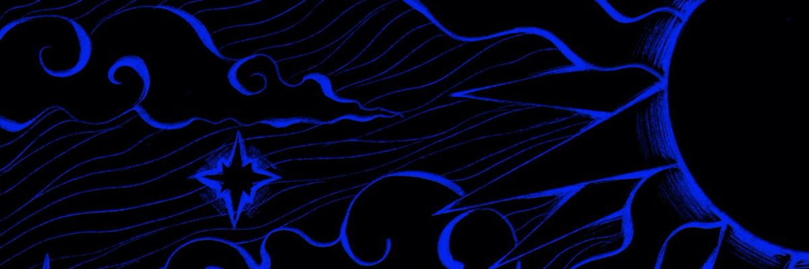

  

  <h1>Berat Şamlı</h1>
  
<b>DevOps Engineer</b>

  
<i>Automate, ship, observe.</i>

 

<h3 align="center">🛠️ Tech Stack</h3>

  &nbsp;&nbsp;
  &nbsp;&nbsp;
  &nbsp;&nbsp;
  &nbsp;&nbsp;
  &nbsp;&nbsp;
  

  &nbsp;&nbsp;
  &nbsp;&nbsp;
  &nbsp;&nbsp;
  &nbsp;&nbsp;
  &nbsp;&nbsp;
  

 

  
  

  

